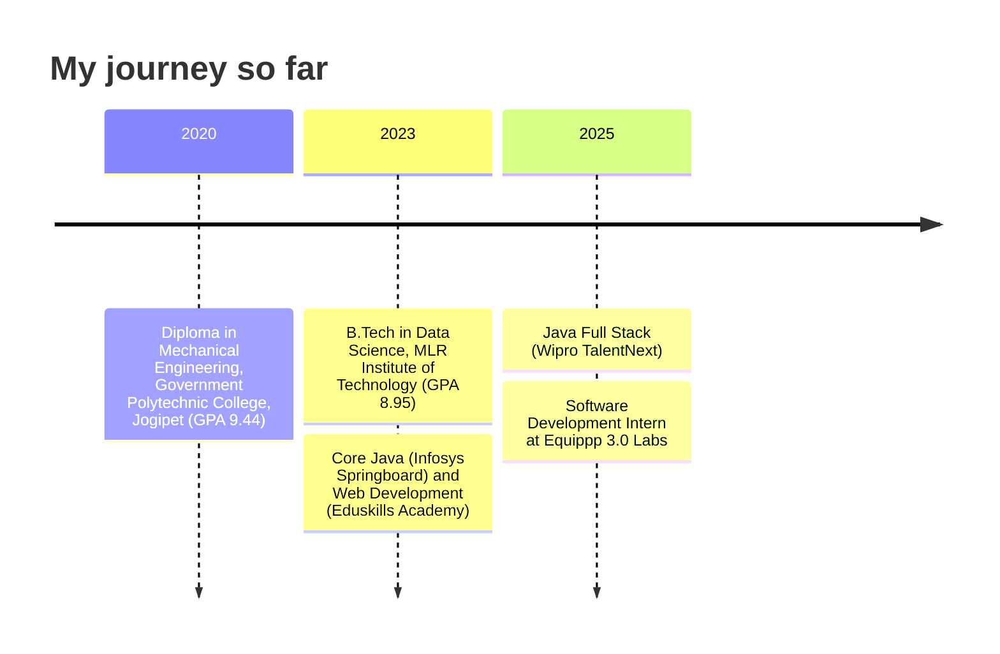

<!--
  ==========================================================================
  Sampath Yadav Gundaram | GitHub profile README
  This file must live in a PUBLIC repo named exactly: Sampath-yadav/Sampath-yadav
  Lines starting with "EDIT:" in an HTML comment mark things you can change.
  ==========================================================================
-->

<div align="center">

<!-- Hero banner -->


<!-- Animated typing text. EDIT: change the lines (spaces are written as +, separate lines with ;) -->
<a href="https://github.com/Sampath-yadav">
  
</a>

<br/>

<!-- Contact badges -->
<a href="https://www.linkedin.com/in/sampathyadav40/"></a>
<a href="mailto:sampath.20304m040@gmail.com"></a>
<a href="https://github.com/Sampath-yadav?tab=repositories"></a>
<!-- EDIT: when your portfolio is live, uncomment the next line and put your real URL in href
<a href="https://YOUR-PORTFOLIO-URL"></a>
-->

<br/><br/>


</div>

---

## 👋 About me

I build full-stack web applications and put large language models to work inside real products. My work spans typed APIs, relational databases, conversational AI agents, and responsive interfaces translated straight from Figma. Right now I'm a software development intern shipping features into live company platforms.

```typescript
const sampath = {
  name: "Sampath Yadav Gundaram",
  role: "Software Developer",
  location: "Hyderabad, Telangana, India",
  education: "B.Tech in Data Science, MLR Institute of Technology (GPA 8.95/10)",
  now: "Software Development Intern @ Equippp 3.0 Labs",
  dailyStack: ["Next.js", "TypeScript", "tRPC", "Drizzle ORM", "PostgreSQL"],
  aiWork: ["Gemini API", "Agentic AI", "Conversational AI", "Prompt Engineering"],
  lookingFor: "Software developer roles in full-stack and AI integration",
  reachMe: "sampath.20304m040@gmail.com",
};
```

<!-- EDIT: add a "funFact" line to the object above if you want a personal touch -->

### 🎯 What I do

- 🧱 **Full-stack web apps**: Next.js, TypeScript and tRPC on the front, PostgreSQL with Drizzle ORM behind it
- 🤖 **AI agents**: voice and web assistants that turn natural language into database actions
- 🎨 **Figma to code**: pixel-accurate, mobile-responsive interfaces
- 🚢 **Shipping**: Git, code reviews, Agile sprints and automated CI/CD deployments

---

## 🛠️ Tech stack

<div align="center">

**Languages**<br/>


**Frontend**<br/>


**Backend and APIs**<br/>


**Databases**<br/>


**AI**<br/>


**Tools and platforms**<br/>


</div>

---

## 🚀 Featured projects

<!-- EDIT: add a "Live" link in the last column when a project has a public URL, e.g. [Live](https://...) -->

| Project | What it does | Built with | Links |
| :-- | :-- | :-- | :-- |
| 🗓️ **Sahay**<br/>Conversational AI scheduling | Voice and web AI agent that books appointments through natural conversation, automating 100+ daily appointments. A serverless backend turns natural-language requests into reliable database operations. | TypeScript, PostgreSQL, Gemini API, Netlify Functions | [Code](https://github.com/Sampath-yadav/Sahay-Project) |
| ✅ **Task Manager**<br/>Internship project | Task management app with secure authentication, role-based authorization and a real-time dashboard. | Next.js, TypeScript, tRPC, Drizzle ORM, PostgreSQL (Supabase), Google OAuth | [Code](https://github.com/Sampath-yadav/Task-Manager-with-Authentication) |
| 💬 **Website AI Chatbot**<br/>Internship project | AI-powered chatbot for a company website that routes visitors to the right page. | JavaScript, Python | [Code](https://github.com/Sampath-yadav/3.0-chatBot) |
| 📄 **Journal Automation (pdfGen)** | Local tool that turns LaTeX journal templates into publication-ready PDFs through a web interface and API. Runs offline on Windows, with optional Gemini or Groq assistance. | Python, FastAPI, LaTeX | [Code](https://github.com/Sampath-yadav/Journal_Automation) |
| 🩺 **VDTS Case Study**<br/>Incident Management System | Responsive case-study site with 12 modular sections, scroll-triggered animations, animated counters and an interactive ticket-lifecycle viewer. | Next.js 14, Tailwind CSS | [Code](https://github.com/Sampath-yadav/VDTS) |
| 🧘 **Mental Wellness** | Mobile app built with Expo (React Native). | TypeScript, Expo | [Code](https://github.com/Sampath-yadav/Mental-Wellness) |

<details>
<summary><b>More from my internship</b></summary>
<br/>

- Designed a mobile-responsive landing page for the **Revision Prep** project, optimized across all devices
- Converted **Figma designs** into production-ready UI code for mobile applications with pixel-perfect implementation
- Built and deployed features across multiple production-grade projects with cross-functional teams

</details>

<details>
<summary><b>More repositories</b></summary>
<br/>

[3.0-Website](https://github.com/Sampath-yadav/3.0-Website) (Next.js, team project) ·
[FundPitch](https://github.com/Sampath-yadav/FundPitch) (Next.js) ·
[Newtons](https://github.com/Sampath-yadav/Newtons) (Next.js, Prisma) ·
[contact-page](https://github.com/Sampath-yadav/contact-page) (Next.js) ·
[portfolio](https://github.com/Sampath-yadav/portfolio) (TypeScript) ·
[Matrix-School-Website](https://github.com/Sampath-yadav/Matrix-School-Website)

</details>

---

## 💼 Experience and education

**Software Development Intern** · Equippp 3.0 Labs Technologies Pvt. Ltd., Hyderabad · *Oct 2025 to present*
Developing and deploying full-stack web applications across multiple production projects, integrating features into live company platforms, and improving backend workflows and APIs with Agile practices, code reviews and CI/CD.



<details>
<summary><b>Full education details</b></summary>
<br/>

| Institution | Programme | Years | GPA |
| :-- | :-- | :-- | :-- |
| MLR Institute of Technology, Hyderabad | B.Tech in Data Science | 2023 to 2026 | 8.95 / 10 |
| Government Polytechnic College, Jogipet | Diploma in Mechanical Engineering | 2020 to 2023 | 9.44 / 10 |
| Newton's High School, Banswada | SSC | 2010 to 2020 | 10 / 10 |

</details>

---

## 📊 GitHub in numbers

<!-- These cards read live data. They only count what GitHub can see on your profile, so turn on
     "Include private contributions on my profile" in GitHub profile settings. -->

<div align="center">


<br/>


<br/>


</div>

<!-- Contribution snake. It appears after the "Generate snake animation" workflow has run once
     (see .github/workflows/snake.yml). -->
<div align="center">
  <picture>
    <source media="(prefers-color-scheme: dark)" srcset="https://raw.githubusercontent.com/Sampath-yadav/Sampath-yadav/output/github-contribution-grid-snake-dark.svg" />
    <source media="(prefers-color-scheme: light)" srcset="https://raw.githubusercontent.com/Sampath-yadav/Sampath-yadav/output/github-contribution-grid-snake.svg" />
    
  </picture>
</div>

---

## 🏆 Certifications

<!-- EDIT: update the Status column when you finish a course -->

| Certification | Issuer | Date | Status |
| :-- | :-- | :-- | :-- |
| Java Full Stack | Wipro TalentNext (Digital Skills Readiness Program) | Oct 2025 | ✅ Completed |
| The Complete Full-Stack Web Development Bootcamp | Udemy | Nov 2025 | 🔄 In progress |
| OCI AI Foundations Associate | Oracle | Oct 2025 | 🔄 In progress |
| Core Java | Infosys Springboard | Dec 2023 | ✅ Completed |
| Web Development | Eduskills Academy | Nov 2023 | ✅ Completed |

---

## 📚 Currently learning

<!-- EDIT: keep this list honest and current; recruiters read it -->

- 🌐 Full-stack web development through the Udemy bootcamp
- ☁️ Oracle Cloud AI fundamentals (OCI AI Foundations Associate)
- 🤖 Agentic AI and LLM-driven workflows
- 🧩 Cleaner architecture for production-grade TypeScript apps

---

## 🤝 Open to

- 💼 Software developer roles (full-stack and AI integration)
- 🌍 Open-source projects
- 🚀 Freelance opportunities
- 🔬 Research projects
- 💡 Startup ideas

---

## 📬 Connect with me

<div align="center">

I'm happy to talk about roles, projects or anything built with Next.js, TypeScript and AI.

<br/>

<a href="https://www.linkedin.com/in/sampathyadav40/"></a>
<a href="mailto:sampath.20304m040@gmail.com"></a>
<a href="https://github.com/Sampath-yadav"></a>

<br/><br/>

<sub>Thanks for stopping by. If something here caught your eye, say hello.</sub>


</div>
